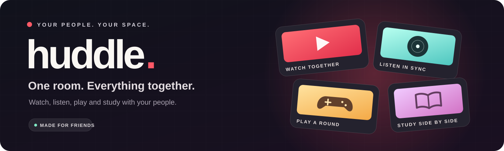

<div align="center">



**Your people, your space.** A shared room for the things you already do together.

[Explore Huddle](#inside-the-room) &nbsp;·&nbsp; [Get started](#getting-started) &nbsp;·&nbsp; [How it works](#how-it-works) &nbsp;·&nbsp; [Configuration](#configuration)


</div>

---

## Inside the room

Huddle brings friends into one shared space. Start a film, put on a song, play a quick game, or get some work done together—all while staying in the same room and conversation.

<table>
<tr>
<td width="50%">

### 🔴 Watch together

Share YouTube, direct video links, or uploaded films. Play, pause, seek, and speed changes follow the room's shared playback state.

</td>
<td width="50%">

### 🟢 Listen in sync

Build a shared music queue, spin through the record view, and follow time-synced lyrics and a live visualiser.

</td>
</tr>
<tr>
<td width="50%">

### 🟡 Play a round

Gather around Mafia, Somewhere, Draw & Guess, Pen Fight, Trivia, Guess the Song, Truth or Dare, and How Well Do You Know Me?

</td>
<td width="50%">

### 🟣 Study side by side

Keep subjects, documents, notes, quizzes, lessons, a tutor, a focus timer, and coding problems together in one workspace.

</td>
</tr>
</table>

The **3D hub** brings the room to life with characters, pets, emotes, a photo booth, chat, and voice/video calls. Rooms are private by default; an open room can be discovered by others.

## The games

| Game | The idea |
| --- | --- |
| **Mafia** | Hidden roles, night moves, discussion, and votes in a cinematic mystery. |
| **Somewhere** | Explore a Street View location and guess where you are. Play classic rounds or a duel. |
| **Draw & Guess** | Draw a word while everyone races to guess it. Includes custom words and drawing tools. |
| **Pen Fight** | Flick your pen across a classroom desk. Challenge a friend, pass and play, or practise solo. |
| **Live Trivia** | Race through questions, use power-ups, and see the answers revealed together. |
| **Guess the Song** | Recognise tracks from short clips across different music categories. |
| **Truth or Dare** | Pick your comfort level and let the room take turns. |
| **How Well Do You Know Me?** | Predict a friend's answers and find out how well you know them. |

## Getting started

You need **Node.js 22.12 or newer**, npm, and a recent browser with WebGL support for the 3D scenes. The server uses SQLite through Prisma.

**1. Install the frontend and server dependencies.**

```bash
npm install
npm --prefix server install
```

**2. Create the server configuration.**

```bash
cp server/.env.example server/.env
```

Set a fresh `JWT_SECRET` in `server/.env` before exposing the app. The example also documents the database, port, allowed origins, and optional integrations. Keep `.env` files and credentials out of Git.

**3. Prepare the database and start both services.**

```bash
npm --prefix server run generate
npm --prefix server run db:push
npm run dev:all
```

Open **http://localhost:5173**. The API defaults to **http://localhost:4000**. Vite proxies the API and Socket.IO during local development.

> **Already running a server?** Use a separate port and a separate test database for experiments so you don't interrupt an existing room or overwrite its data.

## Configuration

Most integrations are optional and live in `server/.env`; see [`server/.env.example`](server/.env.example) for the complete list. Features that require a provider need the corresponding credentials and may incur provider charges.

| Feature | Configuration | Where |
| --- | --- | --- |
| **Somewhere: map and Street View** | `VITE_GOOGLE_MAPS_API_KEY` | Root `.env`; browser key restricted to your website referrers and Maps JavaScript API. |
| **Somewhere: location lookup** | `GOOGLE_MAPS_SERVER_KEY` | `server/.env`; separate server key restricted to Street View Static API. |
| **AI study tools** | `AZURE_OPENAI_ENDPOINT`, `AZURE_OPENAI_API_KEY` and deployment settings | `server/.env`; embeddings and speech can use separate resources. |
| **YouTube search** | `YOUTUBE_API_KEY` | `server/.env`; pasted YouTube links work without search. |
| **Calls across networks** | `METERED_API_KEY` + `METERED_DOMAIN`, or `TURN_URL`, `TURN_USERNAME`, `TURN_CREDENTIAL` | `server/.env`; a TURN relay helps when direct connections cannot be established. |
| **Cloud video storage** | `R2_*` settings | `server/.env`; without R2, uploads are served locally. |
| **Split frontend/API** | `VITE_API_URL`, `CLIENT_ORIGIN`, and `CROSS_SITE` | Frontend and server environments; configure allowed origins and HTTPS deliberately. |

A browser Maps key is visible to the browser by design, so apply API and referrer restrictions. Never put a server key into frontend code or commit real credentials.

## How it works

```text
                  ┌───────────────────────────────────┐
                  │        React + Vite frontend      │
                  │ Watch · Listen · Play · Study     │
                  └───────────────┬───────────────────┘
                                  │ HTTPS + Socket.IO
                  ┌───────────────▼───────────────────┐
                  │       Express + TypeScript        │
                  │ Rooms · sync · games · services   │
                  └───────────────┬───────────────────┘
                                  │ Prisma
                  ┌───────────────▼───────────────────┐
                  │              SQLite               │
                  └───────────────────────────────────┘
```

- **Shared playback:** clients measure their clock offset against the server and correct drift so the room stays together.
- **Realtime games:** the server manages game state, turns, timers, and per-player views. Pen Fight shots are simulated on the server and replayed on each screen.
- **Study and coding:** study tools use configured AI services; Python and JavaScript can run in the browser, while other languages can use the configured judge.
- **Calls:** WebRTC carries media; the room socket handles signalling, with an optional TURN relay for difficult network paths.

## Project map

```text
src/features/         React features: rooms, games, watch, music, study, and more
src/components/       Shared interface components
src/lib/              API, socket, configuration, and shared helpers
server/src/games/     Party-game rules and Pen Fight physics
server/src/sockets/   Realtime room and feature gateways
server/src/services/  Media, AI, judge, storage, and room services
server/prisma/        Database schema
extension/            Companion browser extension
```

Assets can be placed in `src/assets/characters`, `scenes`, `models`, `landing`, and `videos` according to the app's asset discovery rules.

## Useful commands

| Command | Purpose |
| --- | --- |
| `npm run dev:all` | Run the frontend and API together. |
| `npm run dev` | Run the frontend only. |
| `npm run build` | Typecheck and build the frontend. |
| `npm run lint` | Run Oxlint. |
| `npx tsc --noEmit -p server` | Typecheck the server. |
| `npm --prefix server test` | Run the server test suite. |
| `npm run db:studio` | Open Prisma Studio. |
| `bash server/start-server.sh` | Start the Linux server and its configured tunnel. |

---

<div align="center">

**Made for the people you want in the room.**

<sub>Huddle · Watch together. Listen together. Play together. Study together.</sub>

</div>
